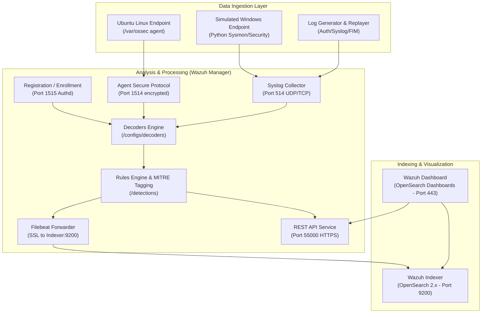

# HomeSOC Architecture & Component Guide

## Overview

HomeSOC is an educational and operational lab environment built on the **Wazuh 4.11.2** architecture. It integrates log collection, threat detection, host-based intrusion detection, and test automation in a containerized environment.

## Network Ports & Protocols

| Port | Protocol | Component | Purpose |
|---|---|---|---|
| 1514 | TCP/UDP | Wazuh Manager | Agent connection and log transmission |
| 1515 | TCP | Wazuh Manager | Agent auto-enrollment service (Authd) |
| 514 | UDP | Wazuh Manager | Syslog ingestion (Windows simulator / network gear) |
| 55000 | TCP | Wazuh Manager | Management REST API |
| 9200 | TCP | Wazuh Indexer | Indexer REST API (TLS secured) |
| 443 | TCP | Wazuh Dashboard | Web UI console |

## Storage & Persistence Strategy
All services utilize persistent Docker volumes:
- `wazuh-indexer-data`: Retains indices, mappings, and alerts over time.
- `wazuh_etc`, `wazuh_logs`, `wazuh_queue`: Manager state, agent keys, queue buffers, and log archives.
- `wazuh-dashboard-config`: Custom dashboards, visual configurations, and tenant data.
