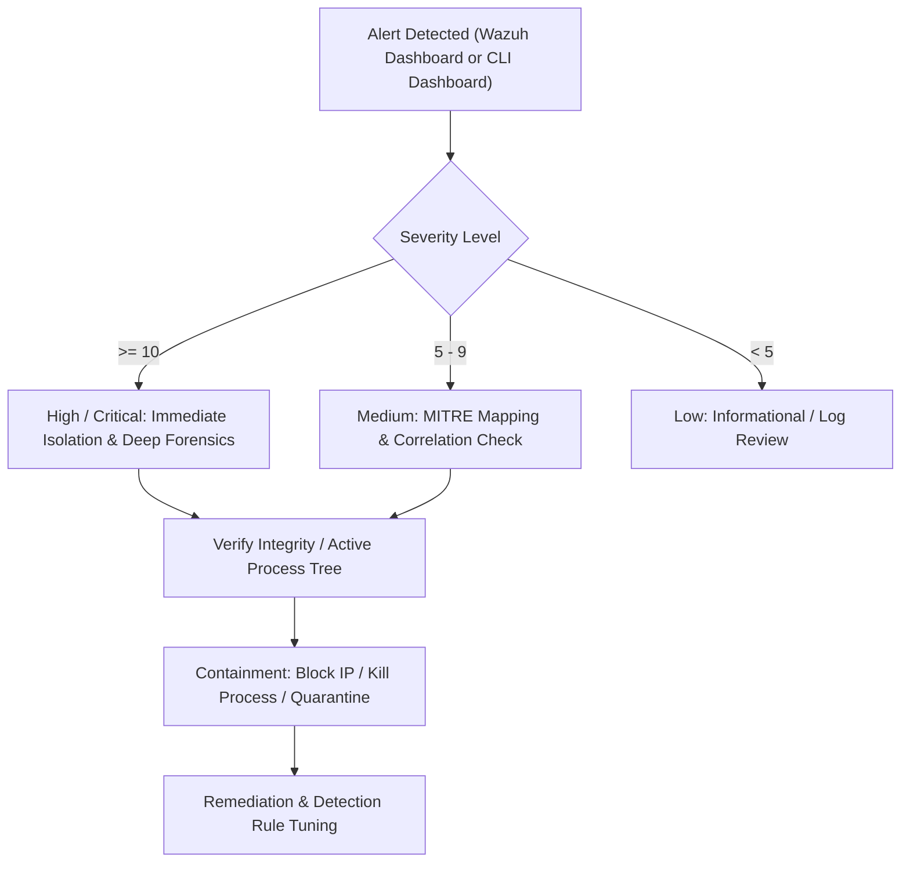

# HomeSOC Incident Triage & Analysis Runbook

This runbook guides analysts through investigating common alert types produced in the HomeSOC environment.

---

## 1. Triage Workflow



---

## 2. Playbooks by MITRE Technique

### A. T1059.001 - Command and Scripting Interpreter: PowerShell
- **Rule ID**: `100002`
- **Indicator**: Encoded commands (`-enc`, `FromBase64String`), download cradles (`IEX`, `DownloadString`).
- **Investigation Steps**:
  1. Inspect the full `command_line` field in Wazuh alerts.
  2. Decode any Base64-encoded payload:
     ```bash
     echo "<encoded-string>" | base64 -d
     ```
  3. Identify the parent process (`ParentImage`) to see if an unexpected process spawned powershell (e.g. `word.exe`, `excel.exe`, `w3wp.exe`).
  4. Check network connections established by the spawned process.

---

### B. T1053.005 - Scheduled Task / Job
- **Rule ID**: `100003`
- **Indicator**: Event ID 4698 or `schtasks.exe /create` commands.
- **Investigation Steps**:
  1. Examine the `TaskName` and action path specified in the task definition.
  2. Verify whether the executable binary is located in volatile or user-writable locations (`%TEMP%`, `%APPDATA%`, `C:\Windows\Temp`).
  3. Validate task trigger schedule (e.g. running on boot or high frequency).
  4. Delete unauthorized tasks:
     ```powershell
     Unregister-ScheduledTask -TaskName "<task-name>" -Confirm:$false
     ```

---

### C. T1078 - Valid Accounts (Anomalous Remote Privileged Logon)
- **Rule ID**: `100004`
- **Indicator**: Event ID 4624 with `LogonType: 10` (Remote Interactive / RDP) or privileged account (`Administrator`, `root`).
- **Investigation Steps**:
  1. Confirm the source IP (`IpAddress`) and workstation name.
  2. Verify if the logon time matches the authorized user's typical schedule.
  3. Cross-reference authentication attempts with previous failed logons (brute force check, Event ID 4625).
  4. Check multi-factor authentication (MFA) logs if applicable.

---

### D. T1003.001 - LSASS Memory Access
- **Rule ID**: `100005`
- **Indicator**: Sysmon Event ID 10 where `TargetImage` is `lsass.exe` and `GrantedAccess` includes read rights (`0x1010` or `0x1FFFFF`).
- **Investigation Steps**:
  1. Identify `SourceImage` (e.g. `mimikatz.exe`, `procdump.exe`, `rundll32.exe`).
  2. Treat immediately as a credential compromise incident.
  3. Revoke all active sessions and initiate password resets for logged-on accounts.
  4. Collect forensic triage images from the endpoint.

---

### E. T1565.001 - File Integrity Monitoring (FIM)
- **Rule ID**: `100010`
- **Indicator**: Modification, creation, or deletion of files in `/monitored`, `/etc`, or critical binaries.
- **Investigation Steps**:
  1. Identify the changed file path, timestamp, and user who performed the change.
  2. Check file hash difference against known baseline.
  3. Inspect system auth logs for concurrent SSH or terminal sessions.
